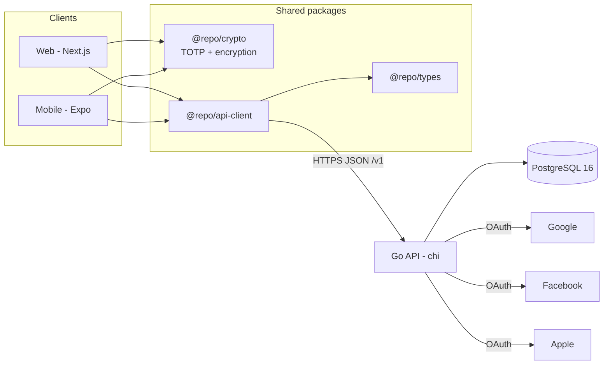
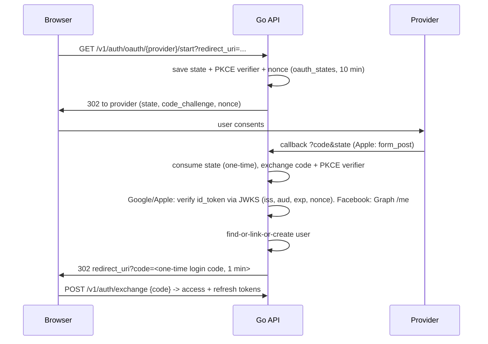
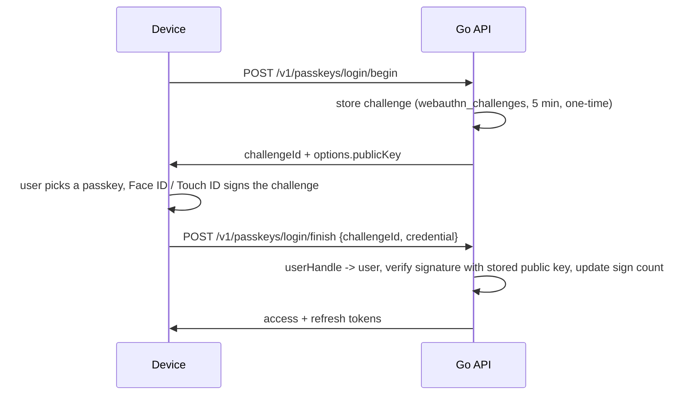

# Architecture

## System overview



**Golden rule:** secrets and codes are computed and decrypted _only on devices_. The server is a
dumb, authenticated store of ciphertext plus the metadata needed to sync it.

## Server layout (layered / hexagonal-ish)

```
cmd/api            main: load config, connect DB, build router, run with graceful shutdown
cmd/migrate        goose runner (embedded SQL)
internal/app       composition root: wires repository -> service -> handler for every module
internal/modules/X handler.go (HTTP) -> service.go (business rules) -> repository.go (DB port + pg adapter)
internal/db        sqlc-generated, type-safe queries (do not edit by hand)
internal/platform  database pool, logger, http server
internal/middleware request logging, Bearer-token auth
pkg/               small reusable libs: httpx (JSON), token (JWT/refresh), applesecret
```

Handlers only translate HTTP <-> Go types. Services hold rules and depend on a `Repository`
**interface**, so you can unit-test a service with a fake repo and no database.

## Authentication

Our own session = **short-lived JWT access token (15 min)** + **opaque rotating refresh token (30 days)**.
Only a SHA-256 hash of the refresh token is stored (`sessions.refresh_token_hash`). The JWT carries
`sub` (user id) and `sid` (the session family id), which is how `POST /devices` knows which session to bind.

### Social sign-in on web (Google, Facebook, Apple)



- **state** stops CSRF, **PKCE** makes a stolen authorization code useless, **nonce** ties the id_token to this attempt.
- `redirect_uri` must start with one of `ALLOWED_REDIRECTS` (no open redirects).
- Tokens never appear in a URL; only a 1-minute, single-use login code does.
- **Apple:** the client secret is an ES256 JWT signed with your `.p8` key (`pkg/applesecret`); the name arrives only on first sign-in.
- Setup steps for each provider: [OAUTH_SETUP.md](OAUTH_SETUP.md).

### Account linking (who is this person?)

`DecideLink` in `modules/auth/repository.go`:

| Identity already linked? | User with same email? | Provider verified the email? | Result                                          |
| ------------------------ | --------------------- | ---------------------------- | ----------------------------------------------- |
| yes                      | –                     | –                            | sign in as that user                            |
| no                       | yes                   | yes                          | link this provider to the existing user         |
| no                       | yes                   | no                           | **409 email_taken** (prevents account takeover) |
| no                       | no                    | –                            | create user + identity                          |

Google and Apple say `email_verified`; Facebook doesn't, so Facebook never links by email.

### Social sign-in on mobile

Native SDKs return an `id_token` (Google, Apple) or an access token (Facebook). The app sends it to
`POST /v1/auth/oauth/{provider}/token` (plus the raw `nonce`). The server verifies it the same way.
Accepted audiences = web client id + `*_EXTRA_AUDIENCES` (iOS/Android client ids, bundle id).

### Passkeys (WebAuthn)



Registration (`register/begin|finish`, needs a session) is the same shape; the device creates a
key pair and we store the public key. Discoverable ("resident") keys mean no username is needed.

### Sessions, devices and remote sign-out

- Refresh rotates the token; presenting an already-rotated token revokes the whole family (likely theft).
- `POST /devices` registers a device and binds the current session family to it.
- `DELETE /devices/{id}` revokes the device **and every refresh token bound to it**. Its current access
  token keeps working until it expires (≤ 15 min), the usual trade-off of stateless JWTs.

### Hardening

- Request IDs (`X-Request-Id` response header), structured request logs.
- Security headers: `nosniff`, `X-Frame-Options: DENY`, CSP `default-src 'none'`, `Cache-Control: no-store`, HSTS in production.
- Rate limit: 30 requests/minute per IP on `/auth/*`, `/passkeys/login/*`, `/dev/*` (429 JSON).
- Activity log (`audit_log`): sign-ins, devices added/revoked, passkeys added/removed, vault created / key changed. `GET /v1/activity`.

## End-to-end encrypted sync

### Key hierarchy

```
master password ──Argon2id(salt, 64 MiB, t=3)──▶ KEK (32 bytes, never leaves device)
random vault key (32 bytes) ──encrypt with KEK──▶ wrapped_key  (stored on server)
each TOTP account (JSON) ──XChaCha20-Poly1305(vault key, random 24-byte nonce, AD=item id)──▶ ciphertext
```

- The server stores: KDF params + salt, `wrapped_key`, and per item `ciphertext`, `nonce`, `version`, `deleted`.
- The server never sees: the master password, KEK, vault key, TOTP secrets, issuer names or labels.
- **Associated data = item id**, so the server can't swap one item's ciphertext into another.
- **Why XChaCha20-Poly1305:** 24-byte nonces are safe to generate randomly; fast in pure JS on phones.
- **Adding a device:** sign in, enter the master password, re-derive the KEK, unwrap the vault key.
  Later: device-to-device approval using `devices.public_key` (wrap the vault key per device) so
  you don't have to type the password everywhere.
- **Changing the master password:** re-derive a new KEK, re-wrap the same vault key. No item re-encryption.
- **Lost master password = lost data** (by design). Offer an exportable recovery key.

### Sync protocol

Items are `account` or `folder` (folders are encrypted too; an account's folder id lives inside its ciphertext).

- `GET /v1/sync/{vaultId}?cursor=N` returns items changed after change-log `seq` N, plus the new cursor.
- `POST /v1/sync` pushes up to 500 changes in one transaction. Rule (`Accepts`): a new item must be
  version 1, an edit must be exactly server version + 1. Anything else comes back in `conflicts`
  with the server copy; the client decrypts both, merges, and pushes version + 1.
- Rows are locked with `SELECT … FOR UPDATE`, so two devices racing on the same item can't both win.
- REST helpers (`PUT/DELETE /vaults/{id}/items/{itemId}`) use the same engine and answer 409 on conflict.
- Every accepted change appends to `sync_changes`; its `seq` is the cursor. Pull returns each changed item once.
- Deletes are tombstones (`deleted = true`) so other devices learn about them.

### TOTP

RFC 6238 on device (`@repo/crypto`): `counter = floor(unixTime / period)`, HMAC (SHA-1/256/512),
dynamic truncation (RFC 4226), N digits. Unit tests check the official RFC 6238 vectors.

## Mobile UI strategy

`packages/ui` is web-only (DOM + Tailwind). Mobile shares **logic** (`crypto`, `api-client`, `types`)
and keeps its own React Native components under `apps/mobile/src/features/*`. If shared visuals are
wanted later, add `packages/ui-native` or adopt a cross-platform kit (e.g. Tamagui, NativeWind).

## Import, export and backups (phase 4)

- **Import** happens on the device: `@repo/importers` turns `otpauth://` links, Google `otpauth-migration://` QR links, 2FAS JSON and Aegis JSON into one `ImportedAccount` shape; the app encrypts each and pushes via sync. Encrypted 2FAS/Aegis exports are refused with a clear message.
- **Transfer**: `toGoogleMigration()` builds Google-compatible QR link batches.
- **Encrypted backup**: client encrypts with a backup-password key (Argon2id + XChaCha20-Poly1305) and uploads ciphertext to `POST /v1/backups`.
- **Download my data**: `GET /v1/users/me/export` (ciphertext stays ciphertext).
- **Issuer icons**: `issuerIcon("GitHub")` → `{ slug, color }`, bundled, no network.
