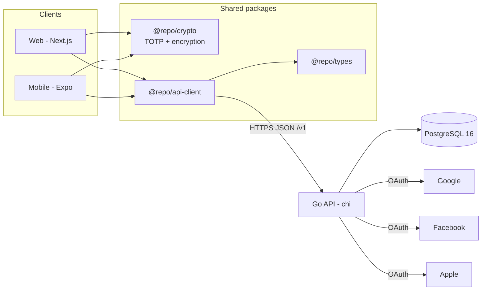
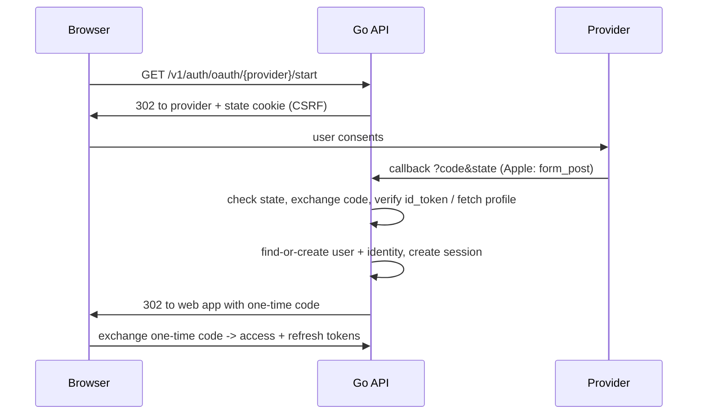
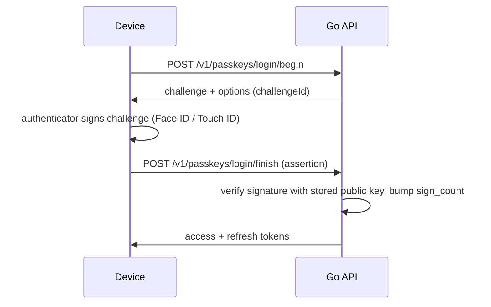

# Architecture

## System overview



**Golden rule:** secrets and codes are computed and decrypted _only on devices_. The server is a
dumb, authenticated store of ciphertext plus the metadata needed to sync it.

## Server layout (layered / hexagonal-ish)

```
cmd/api            main: load config, connect DB, build router, run with graceful shutdown
cmd/migrate        goose runner (embedded SQL)
internal/app       composition root: wires repository -> service -> handler for every module
internal/modules/X handler.go (HTTP) -> service.go (business rules) -> repository.go (DB port + pg adapter)
internal/db        sqlc-generated, type-safe queries (do not edit by hand)
internal/platform  database pool, logger, http server
internal/middleware request logging, Bearer-token auth
pkg/               small reusable libs: httpx (JSON), token (JWT/refresh), applesecret
```

Handlers only translate HTTP <-> Go types. Services hold rules and depend on a `Repository`
**interface**, so you can unit-test a service with a fake repo and no database.

## Authentication

Our own session = **short-lived JWT access token (15 min)** + **opaque rotating refresh token (30 days)**.
Only a SHA-256 hash of the refresh token is stored (`sessions.refresh_token_hash`).

### Social sign-in on web (Google, Facebook, Apple)



- **Google:** OpenID Connect; verify the `id_token` (signature via Google JWKS, `aud`, `iss`, `email_verified`).
- **Facebook:** not OIDC for web logins; call `GET /me?fields=id,name,email` with the access token.
- **Apple:** the _client secret is a JWT_ you sign (ES256) with the `.p8` key, `kid`=Key ID,
  `iss`=Team ID, `sub`=Services ID, `aud`=`https://appleid.apple.com` (see `pkg/applesecret`).
  Apple sends the user's name **only on first sign-in**, so save it then. Uses `response_mode=form_post`.

### Social sign-in on mobile

Native SDKs (Sign in with Apple, Google Sign-In) return an `id_token`. The app sends it to
`POST /v1/auth/oauth/{provider}/token`; the server verifies it against the provider's JWKS and issues our tokens.

### Passkeys (WebAuthn)



Registration is the same shape with `register/begin|finish` (requires an existing session).
Mobile needs an associated domain (`webcredentials:`) / Digital Asset Links so the OS trusts the RP ID.

### Refresh rotation and reuse detection

Each refresh revokes the old session row and creates a new one in the same `family_id`.
If a _revoked_ token is ever presented again, the whole family is revoked (likely theft).

## End-to-end encrypted sync

### Key hierarchy

```
master password ──Argon2id(salt, 64 MiB, t=3)──▶ KEK (32 bytes, never leaves device)
random vault key (32 bytes) ──encrypt with KEK──▶ wrapped_key  (stored on server)
each TOTP account (JSON) ──XChaCha20-Poly1305(vault key, random 24-byte nonce, AD=item id)──▶ ciphertext
```

- The server stores: KDF params + salt, `wrapped_key`, and per item `ciphertext`, `nonce`, `version`, `deleted`.
- The server never sees: the master password, KEK, vault key, TOTP secrets, issuer names or labels.
- **Associated data = item id**, so the server can't swap one item's ciphertext into another.
- **Why XChaCha20-Poly1305:** 24-byte nonces are safe to generate randomly; fast in pure JS on phones.
- **Adding a device:** sign in, enter the master password, re-derive the KEK, unwrap the vault key.
  Later: device-to-device approval using `devices.public_key` (wrap the vault key per device) so
  you don't have to type the password everywhere.
- **Changing the master password:** re-derive a new KEK, re-wrap the same vault key. No item re-encryption.
- **Lost master password = lost data** (by design). Offer an exportable recovery key.

### Sync protocol

- `GET /v1/sync/{vaultId}?cursor=N` returns items changed after change-log `seq` N, plus the new cursor.
- `POST /v1/sync` pushes changes. Each has a `version`; the server only accepts it if it is newer
  (optimistic concurrency). Older writes come back as `conflicts` for the client to merge
  (decrypt both, keep newest per field, re-encrypt, push with version+1).
- Deletes are tombstones (`deleted = true`) so other devices learn about them.

### TOTP

RFC 6238 on device (`@repo/crypto`): `counter = floor(unixTime / period)`, HMAC (SHA-1/256/512),
dynamic truncation (RFC 4226), N digits. Unit tests check the official RFC 6238 vectors.

## Mobile UI strategy

`packages/ui` is web-only (DOM + Tailwind). Mobile shares **logic** (`crypto`, `api-client`, `types`)
and keeps its own React Native components under `apps/mobile/src/features/*`. If shared visuals are
wanted later, add `packages/ui-native` or adopt a cross-platform kit (e.g. Tamagui, NativeWind).
