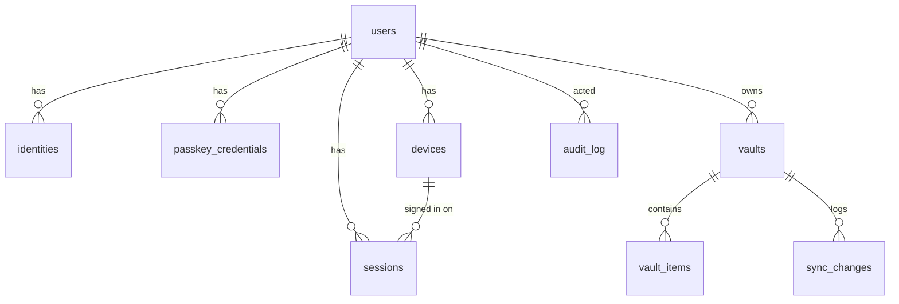

# Database

PostgreSQL 16. Schema lives in `apps/server/migrations` (goose). Queries live in
`apps/server/queries/*.sql`; `sqlc generate` turns them into Go in `internal/db`.

| Table                 | Purpose                              | Key columns                                                                                      |
| --------------------- | ------------------------------------ | ------------------------------------------------------------------------------------------------ |
| `users`               | One person                           | `email` (unique), `display_name`, `avatar_url`                                                   |
| `identities`          | Linked OAuth accounts                | `provider` (google/facebook/apple), `provider_user_id` — unique together                         |
| `passkey_credentials` | WebAuthn public keys                 | `credential_id` (unique), `public_key`, `sign_count`, `transports`, `backup_*`                   |
| `devices`             | Each browser/phone holding the vault | `platform`, `public_key` (for future per-device key wrapping), `revoked_at`                      |
| `sessions`            | Refresh tokens                       | `refresh_token_hash` (SHA-256, unique), `family_id` (rotation chain), `expires_at`, `revoked_at` |
| `vaults`              | Vault header                         | `kdf_*` params + `kdf_salt`, `wrapped_key` (encrypted vault key)                                 |
| `vault_items`         | Encrypted TOTP accounts              | `ciphertext`, `nonce`, `version`, `deleted` (tombstone)                                          |
| `sync_changes`        | Append-only change log               | `seq` (BIGSERIAL = sync cursor), `vault_id`, `item_id`, `version`, `device_id`                   |
| `audit_log`           | Security events                      | `action` (e.g. `login`, `passkey.added`), `ip`, `user_agent`, `metadata` JSONB                   |

Notes:

- All ids are UUIDs (`gen_random_uuid()`), except `vault_items.id`, which the **client** generates
  so it can create items offline and use the id as encryption associated data.
- `ON DELETE CASCADE` from `users` makes "delete my account" one statement.
- Never store plaintext refresh tokens, TOTP secrets or vault keys.
